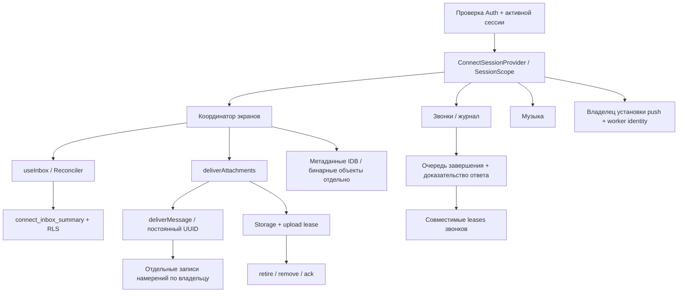

# Архитектура Connect после исправлений

Стек сохранён: Next.js 15, React 19, TypeScript, Supabase Auth/Postgres/Realtime/Storage, Web Push/FCM и WebRTC. Криптографические заготовки не означают включённое E2EE.

`ConnectSessionProvider` публикует только подтверждённую сервером личность. `browserSupabase()` создаёт один SDK-клиент. `SessionScope` синхронно меняет поколение при смене пользователя или чата; завершившаяся асинхронная операция проверяет своё поколение перед изменением интерфейса. CallBridge, CallsHub и музыка потребляют эту же личность.

`app/page.tsx` координирует существующие экраны. Представление сообщений, голос, видео, камера, аватар, модель сообщений, превью, отправка вложений, очередь доставки и транспорт inbox выделены отдельно. UI-порталы получают реальные узлы через `ConnectUiSlots`. Тема вычисляет CSS-переменные из акцента, меню закрываются через callbacks.

При здоровом Realtime inbox и открытый чат сверяются раз в 30 секунд. При отсутствии подписки интервал начинается с 5 секунд, при исключениях растёт до 60. Скрытый документ не опрашивается. Возврат/online вызывают сверку. Realtime дополняется периодической сверкой и журналом удалений: пропуск события не считается доказательством отсутствия изменения.

Сводка inbox возвращает последнюю запись и точный unread для каждого доступного диалога, учитывает серверный/local read, очищенные чаты и скрытые сообщения. Она не заменяет историю: история продолжает использовать курсор `(created_at,id)`, якоря чтения и tombstones. Частично прочитанное окно не пересчитывается по одной последней записи сводки.

Каждая отправка имеет UUID до INSERT. Потерянный ответ проверяется чтением того же ID. Временный сбой оставляет намерение для повтора под тем же владельцем. Файл проходит единую подготовку/загрузку/commit для одиночной отправки и альбома. Неудачная подпись URL после commit не превращает отправку в ошибку. Отмена сессии останавливает перенос и захват ресурсов.

GC сначала фиксирует retirement и lease в БД. Триггеры новых ссылок и GC используют один advisory lock на стабильный путь. Storage API удаляет оригинал и производные; ack разрешён владельцу lease. Потерянный ответ безопасно повторяется. Приватный профиль удаляемого аккаунта обезличивается в той же транзакции, что и удаление Auth; сообщения и журнал собеседника сохраняются.

Важные границы: Edge Functions проверяются Deno отдельно от Next.js; активная схема хранится как snapshot + версионированные upgrades; старые maintenance-функции сохранены только как справочные исходники. Обычный CI не применяет SQL и не публикует сайт.
